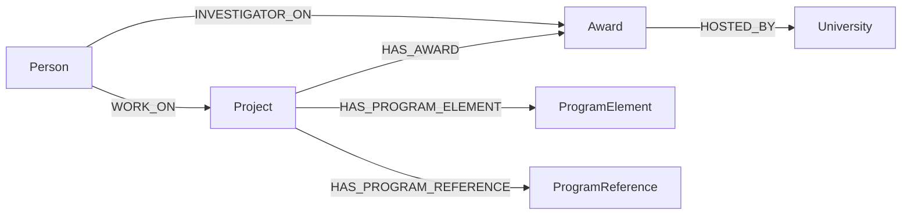

# How to read `nsf-project-workon-enriched`

This database connects the selected 2015–2025 Standard Grant **projects** to their source **awards**, source investigator roster, award recipients, and program codes. It was audited after import. For every stored property, its type, coverage, and definition, see the [data dictionary](DATA_DICTIONARY.md). For the ID-level reconciliation and audit results, see the [reconciliation report](RECONCILIATION_REPORT.md).

## The graph in one view



| Node label | Key | Count | What one node represents |
| --- | --- | ---: | --- |
| `Project` | `project_id` | 17,503 | One selected analysis project. It may group multiple Standard Grant awards by title. |
| `Person` | `source_person_key` | 30,239 | One investigator ID appearing in a selected source-award roster. |
| `Award` | `id` | 24,748 | One original NSF award linked to a selected project. |
| `University` | `source_university_id` | 1,374 | One original graph recipient node. The source label does **not** guarantee it is a degree-granting university. |
| `ProgramElement` | `code` | 552 | One program-element code from the selected source graph. |
| `ProgramReference` | `code` | 959 | One program-reference code from the selected source graph. |

| Relationship | Direction | Count | Meaning |
| --- | --- | ---: | --- |
| `WORK_ON` | `Person` → `Project` | 48,509 | Investigator belongs to that project's union of selected source-award PI rosters. |
| `HAS_AWARD` | `Project` → `Award` | 24,748 | This selected project includes that source award. Each Award has one Project here. |
| `INVESTIGATOR_ON` | `Person` → `Award` | 73,212 | Investigator appears on that specific award's `original_pi` roster; the edge carries award-specific roles and dates. |
| `HOSTED_BY` | `Award` → `University` | 24,748 | Exact original source award-recipient link. Each Award has one recipient here. |
| `HAS_PROGRAM_ELEMENT` | `Project` → `ProgramElement` | 23,296 | Program-element code attached to the selected project. |
| `HAS_PROGRAM_REFERENCE` | `Project` → `ProgramReference` | 40,626 | Program-reference code attached to the selected project. |

The program nodes contain **codes only**, with no program name or description. They describe the selected grouped project, not necessarily every individual source award. Thirty projects have no program-element link in the source; 1,857 have no program-reference link. No link was inferred for them.

## Which unit should I count?

- Count `Project` for selected analysis projects. `Project.year`, `amount`, and `combined_project` come from the selected project record. `combined_project=1` means multiple **Standard Grant** awards were grouped by title in the original selection.
- Count `Award` for individual linked awards. Use `Award.start_date`, `total_amount`, and `tran_type` for award-level timing, money, and instrument type. Do not add `Project.amount` and `Award.total_amount` together.
- `Project.linked_award_ids` equals the selected awards reachable through `HAS_AWARD`. `Project.full_linked_award_ids` is a broader same-title list across instrument types; some of those IDs are **not** Award nodes here. Do not use that broader list as the denominator for this graph's awards.
- Count distinct `Person.source_person_key` for people. `WORK_ON` counts person–project positions, while `INVESTIGATOR_ON` counts person–award positions. The same person can appear on several projects and awards.
- Count `University` nodes for distinct original recipient nodes, and count `HOSTED_BY` links for awards with recipients. These denominators are different.

## Roles, profile data, and eligibility

`WORK_ON.role` is one priority project-level role drawn from the roles on a person's selected awards. `WORK_ON.roles` keeps all those roles, and `source_award_ids` identifies the underlying awards. For an investigator's role on a **particular award**, use `INVESTIGATOR_ON.role` and `INVESTIGATOR_ON.roles`; its `pi_start_dates` and `pi_end_dates` are source roster dates.

`Person.subjects` is a list of Scopus-derived tags. `Person.affiliation` is recorded affiliation text and may be current rather than award-time affiliation. `Person.department` is separate and is not required for the agreed coverage rule. The `subjects_source`, `affiliation_source`, and `department_source` properties identify where each field came from; an empty source string means no value was found. Selected-graph values take precedence over exact nine-digit matches in `original.PI`. No `nsf-csv2` profile was joined in this version.

`Person.profile_usable=true` means subjects is nonempty **and** affiliation is nonblank. For each project, `expected_team_size` is the distinct source roster, `usable_team_count` counts usable members, and `profile_coverage` is their ratio. `Project.analysis_eligible=false` only when **more than half** the source team lacks usable detail. Exactly-half coverage is eligible. The current graph has 17,487 eligible and 16 flagged projects; flagged projects and their links remain present. Legacy fields such as `team_complete`, `team_majority`, `csv_pi_*`, and `unique_original_pi_found_share` are not this eligibility decision.

Most `Person.source_person_key` values are nine-digit numeric NSF IDs and also appear as `nsf_id`. Forty-two people have nine-character alphanumeric source IDs; they remain in the roster, but have no numeric `nsf_id` or exact numeric profile match. Join people within this graph on `source_person_key`.

## Reading the recipient

`HOSTED_BY` preserves the recipient linked to the individual award in `original`. The `University` label is inherited from that database; it can represent a legal awardee, other organization, or an individual. `name`, `city`, `zip`, and all coded classification properties are raw source values. `source_university_id` is the original graph's **snapshot** `elementId`, not a stable external institution identifier.

`verified_unitid` exists only for 612 recipient nodes whose 2025 Carnegie identity match was verified. `institution_match_status` records verified or unresolved status for every recipient. Do not treat an unresolved node as a verified campus match. `research2025_value` is the raw source code: `1`, `2`, or `3` is a recorded research tier; `-2` means **No research designation**; `-99` means **not found**. `research2025_status` makes those cases explicit. Read each coded `*_value` with its paired `*_description`. These 2025 classifications are retrospective relative to older awards.

This graph contains the original award-recipient `HOSTED_BY` path. It does not contain the selected graph's `LEAD_INSTITUTION` or `AFFILIATED_WITH` relationships; `Person.affiliation` is text, not an institution edge. Do not infer a person's award-time institution from the award recipient.

## Read-only Cypher examples

Run this Browser command first, separately from a Cypher query:

```cypher
:use `nsf-project-workon-enriched`
```

### See one project and its awards

```cypher
MATCH (pr:Project {project_id: '1442280'})-[:HAS_AWARD]->(a:Award)
RETURN pr.project_id, pr.title, pr.year, pr.analysis_eligible,
       pr.linked_award_ids, pr.full_linked_award_ids,
       a.id AS award_id, a.start_date, a.tran_type, a.total_amount
ORDER BY award_id;
```

### Read the project roster and profile sources

```cypher
MATCH (p:Person)-[w:WORK_ON]->(pr:Project {project_id: '1442280'})
RETURN p.source_person_key, p.name, w.role, w.roles, w.source_award_ids,
       p.subjects, p.subjects_source, p.affiliation, p.affiliation_source,
       p.department, p.profile_usable
ORDER BY p.name;
```

### Read award-specific investigators and recipients

```cypher
MATCH (pr:Project {project_id: '1442280'})-[:HAS_AWARD]->(a:Award)
MATCH (p:Person)-[io:INVESTIGATOR_ON]->(a)
MATCH (a)-[:HOSTED_BY]->(u:University)
RETURN a.id AS award_id, p.source_person_key, p.name,
       io.role, io.roles, io.pi_start_dates, io.pi_end_dates,
       u.name AS raw_recipient, u.institution_match_status,
       u.verified_unitid, u.research2025_description
ORDER BY award_id, p.name;
```

### Read both kinds of program codes

```cypher
MATCH (pr:Project {project_id: '1442280'})
OPTIONAL MATCH (pr)-[:HAS_PROGRAM_ELEMENT]->(e:ProgramElement)
WITH pr, collect(DISTINCT e.code) AS element_codes
OPTIONAL MATCH (pr)-[:HAS_PROGRAM_REFERENCE]->(r:ProgramReference)
RETURN pr.project_id, element_codes, collect(DISTINCT r.code) AS reference_codes;
```

### Count eligibility and missing recipient classifications

```cypher
MATCH (pr:Project)
RETURN pr.analysis_eligible AS eligible, count(pr) AS projects
ORDER BY eligible;
```

```cypher
MATCH (a:Award)-[:HOSTED_BY]->(u:University)
RETURN u.research2025_status AS raw_research_status,
       count(a) AS awards, count(DISTINCT u) AS recipient_nodes
ORDER BY awards DESC;
```

The source package and full post-import check are recorded in `prepared/manifest.json` and `prepared/target_audit.json` next to this guide.
