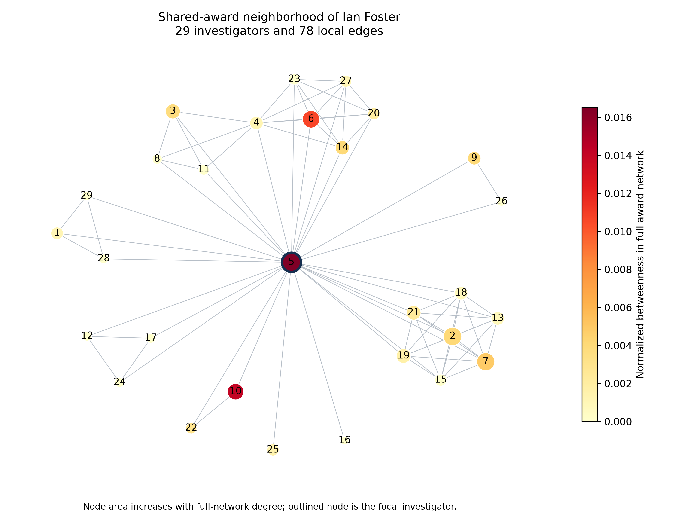

# RQ3 Investigator network prominence and funding exposure

RQ3 asks which investigators occupy prominent or bridging positions in the
selected NSF award network, and how these positions relate to participation
and associated award funding. Centrality is network prominence; it does not
establish research quality, personal funding or proposal success.

## Step 1 Retain the complete investigator population

Run Q04 and Q08 in [RQ3_STEPS.cypher](../queries/RQ3_STEPS.cypher).
The population is all **30,239 Person nodes**, including former-role-only
investigators. Q04 describes grouped-project participation: 20,448 people
appear on one project and 9,791 on at least two. Q08 checks profile and
program coverage; it does not compute centrality.

Baseline outputs: [project activity](../results/rq3/RQ3_project_activity_histogram.csv),
[exclusive roles](../results/rq3/RQ3_exclusive_person_roles.csv),
[role positions](../results/rq3/RQ3_project_role_positions.csv).
Role-group queries are in
[SUPPLEMENTAL_CHECKS.cypher](../queries/SUPPLEMENTAL_CHECKS.cypher).

## Step 2 Extract the actual graph inputs

[RQ3_NETWORK_SOURCE_READS.cypher](../queries/RQ3_NETWORK_SOURCE_READS.cypher)
shows the read-only source queries for people, award memberships, individual
amounts, grouped-project memberships, and award ownership. The corresponding
prepared inputs are:

| Prepared file | Use |
| --- | --- |
| `people.jsonl.gz` | Stable source IDs and stored names; retain every node |
| `investigator_on.jsonl.gz` | Primary individual-award roster |
| `awards.jsonl.gz` | Distinct award IDs and `total_amount` |
| `work_on.jsonl.gz` | Project counts and sensitivity projection |
| `has_award.jsonl.gz` | Reconcile each award to its grouped-project owner |

The files are in [data/prepared](../data/prepared/manifest.json). The centrality
run uses these files without connecting to a database. Extraction Cypher is
not itself a betweenness or eigenvector calculation.

## Step 3 Project the investigator network

Connect two distinct source person IDs if they share an individual selected
award. Include every recorded role, including former roles. Deduplicate
person–award entries and retain all people even if they have no projected
neighbors. A shared roster does not establish simultaneous service.

The network is simple, undirected and unweighted. Repeated shared awards are
stored as `shared_units` in [award_edges.csv](../results/rq3/award_edges.csv),
but do not shorten centrality paths.

Expected network: **50,882 edges, 4,355 components, 15,433 people in the largest
component, and zero isolated people**. There are 8,293 people with positive
betweenness. Retaining isolates remains part of the method even though this
snapshot has none.

## Step 4 Calculate the three distinct centralities

```shell
python analysis/analyze_award_centrality.py
```

| Measure | Definition | Population | Expected leader |
| --- | --- | --- | --- |
| Degree | Distinct neighbors divided by 30,238 | All 30,239 people | Jennifer Zaspel: 44 neighbors |
| Betweenness | Fraction of other-person shortest paths passing through a node, summed exactly | All 30,239 people | Ian Foster: normalized score about 0.016510 |
| Eigenvector | Leading adjacency eigenvector, scaled to maximum one | Largest component only: 15,433 people | Jennifer Zaspel: 1.000000 |

Betweenness excludes endpoints, counts each unordered endpoint pair once,
and treats unreachable pairs as zero. Multiply raw values by
`2 / (30,238 * 30,237)` to normalize across the full population. There is no
sampling, path cutoff or edge weighting.

For eigenvector, solve `A x = lambda x` within the largest component. Outside
that component, the score and rank are unavailable, not zero. The component
is independently connected and the relative equation residual is below
`1e-9`. The solver reports many nearly zero entries: 6,004 scores are below
`1e-12`. This is documented numerical score concentration, not a reason to
claim that the checked component is disconnected. Do not interpret tiny
low-score differences as meaningful rankings.

## Step 5 Read the full population and the top tens

The [complete investigator CSV](../results/rq3/award_investigator_centrality.csv)
contains IDs, names, roles, awards, projects, funding counts, three scores,
ranks, component size and largest-component membership. Keep source IDs as
text so leading zeros survive spreadsheet imports.

Separate top-ten files:

- [Degree](../results/rq3/award_top10_degree.csv)
- [Betweenness](../results/rq3/award_top10_betweenness.csv)
- [Eigenvector](../results/rq3/award_top10_eigenvector.csv)
- [Award participation](../results/rq3/award_top10_award_participation.csv)
- [Associated funding](../results/rq3/award_top10_funding.csv)

Competition ranks use scores rounded to 12 decimals to suppress numerical
solver noise. Ties share a rank and later ranks skip positions. Source person
keys break display ties, retaining exactly ten rows; other people tied at the
cutoff can be omitted. No combined performance score is calculated.

## Step 6 Calculate funding exposure correctly

Count distinct award IDs per investigator. Sum positive `Award.total_amount`
once per award per person. Record positive, zero, negative and missing-amount
counts separately. Missing-only totals are unavailable rather than zero;
incomplete records are excluded from funding rankings and correlations.
All 30,239 investigators in this snapshot have complete numeric amounts.

The full amount of an award is associated with each rostered investigator.
It is exposure, not personal income or an allocated budget share. Investigator
totals overlap and must not be summed into a portfolio total.

Optional direct Cypher checks are in
[RQ3_DIRECT_DEGREE_AND_FUNDING.cypher](../queries/RQ3_DIRECT_DEGREE_AND_FUNDING.cypher).
Deduplicate awards before summing; `SUM(DISTINCT award.total_amount)` is wrong
because separate awards can have equal dollar amounts.

## Step 7 Compare measures and funding

[award_spearman_correlations.csv](../results/rq3/award_spearman_correlations.csv)
records each pair's sample size and descriptive Spearman correlation.
It uses average ranks on 12-decimal-rounded scores. Degree and betweenness
retain all people; eigenvector comparisons use the largest component.

Betweenness correlates with award participation at about 0.695 and funding
exposure at 0.513. Eigenvector correlates with those variables at about 0.232
and 0.162 within its component. These associations share roster inputs and
do not establish effects of centrality on funding.

[award_top10_overlaps.csv](../results/rq3/award_top10_overlaps.csv) shows that
degree and betweenness share one displayed investigator, degree and
eigenvector share six, and betweenness and eigenvector share none.

## Step 8 Check the effect of project grouping

The same script recalculates the measures using shared grouped-project
membership. The `grouped_project_` files retain the same people and individual
award funding values. The sensitivity graph has 51,672 edges, 4,304 components
and 15,572 people in its largest component: grouping adds 790 edges.

[network_sensitivity.csv](../results/rq3/network_sensitivity.csv) records
between-network correlations and top-ten overlap. All three centrality top
tens retain their displayed members, while some scores and ranks change.
Degree and betweenness comparisons use all 30,239 people. Eigenvector
comparison uses 15,433 people common to the two largest components, with
scores calculated in each projection's own component population.

The grouped degree and betweenness exports are also checked against the
unchanged [historical analysis](../evidence/historical_centrality/summary.json).

## Step 9 Inspect the local graph figure



The induced one-hop neighborhood of Ian Foster contains 29 people and all
78 edges among them. Node area increases with full-network degree, color
indicates full-network normalized betweenness, and outlined node 5 is Foster.
[ego_node_legend.csv](../results/rq3/ego_node_legend.csv) maps numbers to names
and stable IDs; [ego_edges.csv](../results/rq3/ego_edges.csv) lists plotted
edges. This is a local illustration, not the entire network or a community
detection result.

## Step 10 Verify independently

```shell
python analysis/test_award_centrality.py
python analysis/verify_award_centrality.py
python scripts/check_repository.py --full
```

Seven synthetic tests compare paths, stars, triangles and disconnected graphs
against NetworkX, check the eigenvector equation, and test duplicate links,
former roles, isolates, funding, ties and unavailable scores. Production checks
reconcile all person IDs, activity, Decimal funding sums, edges, component
identities, top-ten values and figure nodes/edges. The portable verifier
records 31 checks in [verification.json](../results/rq3/verification.json).
The repository checker adds complete file-integrity and cross-RQ checks.
